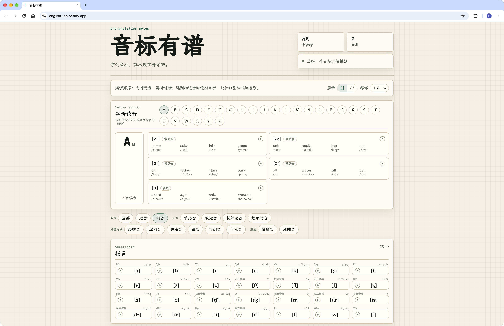

# 音标有谱

<a href="https://english-ipa.netlify.app" target="_blank" rel="noopener noreferrer">在线预览</a>

> 为英语初学者准备的音标点读站点，共计 48 个音标。



## 功能

- 48 个英语音标：按单元音、双元音、辅音分类区分。
- 分类筛选：支持按元音、辅音、长短音、发音方式、清浊筛选。
- 点击播放：点击音标播放对应发音。

## 字体

[霞鹜文楷](https://github.com/lxgw/LxgwWenkai)

## 本地运行

```bash
pnpm install
pnpm dev
```

## 构建

```bash
pnpm build
pnpm preview
```

## 参考来源

音频参考：

- <https://github.com/boommanpro/phonetic_symbol_web/tree/main/words-voice>

版权说明：

本项目仅用于学习目的，音标内容版权归原网站所有。原网站：<https://www.yyybabc.com/>
